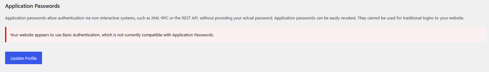
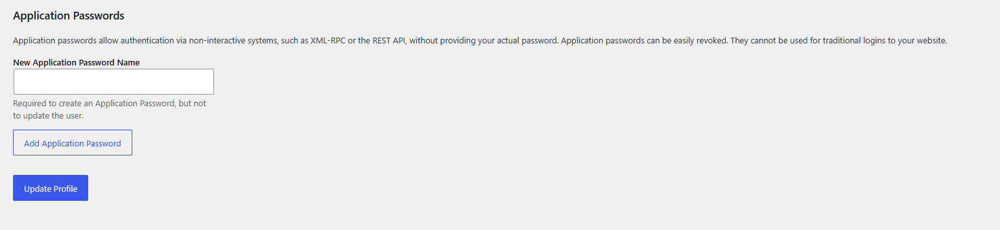
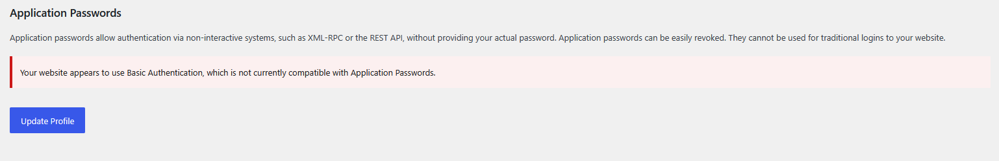

# Test Report – Ticket #66000

**Ticket:** [#66000](https://core.trac.wordpress.org/ticket/66000) – Application Passwords warning persists after HTTP Basic Authentication is disabled

**Patch tested:** [GitHub PR #13597](https://github.com/WordPress/wordpress-develop/pull/13597)

**WordPress version:** 7.2-beta1-64606-src (trunk)

**Environment:** Local WordPress development environment using Docker, Nginx, PHP 8.3 and MySQL

**Browser:** Firefox

## Steps to reproduce

1. Enable HTTP Basic Authentication in the Nginx configuration.
2. Access the WordPress administration area and authenticate using HTTP Basic Authentication.
3. Navigate to the user profile and verify that the Application Passwords section displays a warning.
4. Disable HTTP Basic Authentication in Nginx without clearing the browser's cached credentials.
5. Reload the user profile page.

## Actual result before applying the patch

The Application Passwords warning remained visible even though HTTP Basic Authentication had been disabled. The browser continued sending the cached Basic Authorization header, causing WordPress to incorrectly detect that the site was still protected.



## Result after applying the patch

After applying [GitHub PR #13597](https://github.com/WordPress/wordpress-develop/pull/13597), the warning disappeared and the Application Passwords section became available again, even while the browser continued sending the cached Basic Authorization header.



HTTP Basic Authentication was then re-enabled to verify that the warning appeared again and the Application Passwords section was hidden as expected.



Finally, HTTP Basic Authentication was disabled again, and the Application Passwords section became available.

## Automated testing

The PHPUnit tests included in [GitHub PR #13597](https://github.com/WordPress/wordpress-develop/pull/13597) were executed using:

```bash
npm run test:php -- --filter Tests_Load_WpIsSiteProtectedByBasicAuth
```

**Result: OK (16 tests, 17 assertions).**

The existing tests from trunk were also executed before applying the PR's updated test file. Three of eight tests failed due to external HTTP requests that were not mocked by the existing tests. After applying the updated test file included in the PR, all 16 tests passed successfully.

PHP syntax validation and `git diff --check` also completed without errors.

## Additional observation

The PR reported merge conflicts during testing. The tested trunk version already contained a test file at `tests/phpunit/tests/load/wpIsSiteProtectedByBasicAuth.php`, associated with ticket [#65819](https://core.trac.wordpress.org/ticket/65819).

The patch introduced a file at the same path. The existing and new tests may need to be reconciled before the PR can be merged.

## Conclusion

The patch successfully resolved the reported issue in the tested environment. Manual testing confirmed the expected behavior with HTTP Basic Authentication both enabled and disabled, and all 16 PHPUnit tests included in the PR passed.
